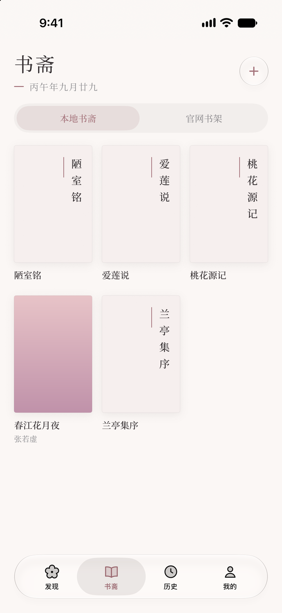
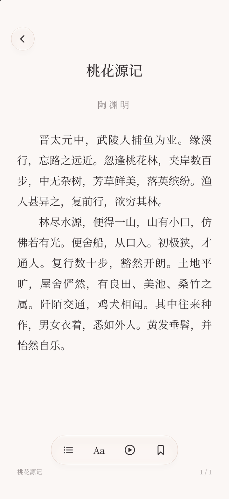
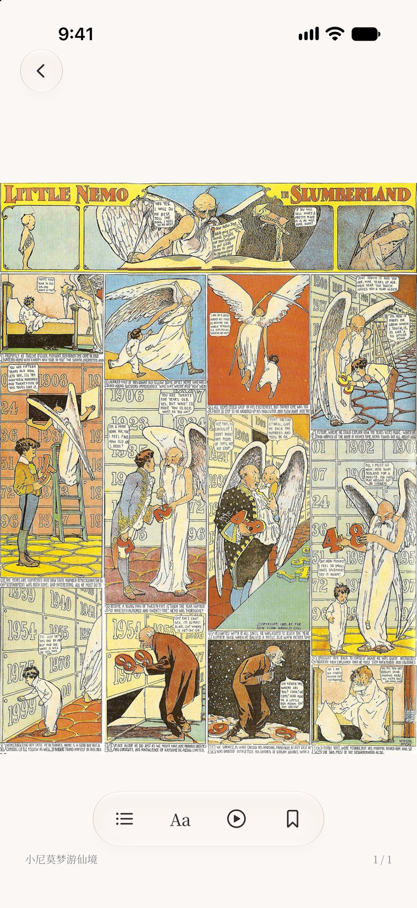

<div align="center">
  
  <h1>落叶 · Luoye</h1>
  <p><strong>把故事留在手边</strong></p>
  <p>为 iPhone 和 iPad 打造的原生阅读器，支持电子书与漫画两种模式。</p>
  <p><code>iOS 26+</code> · <code>SwiftUI</code> · <code>GPL-3.0</code></p>
  <p><a href="#界面预览">界面预览</a> · <a href="#阅读功能">阅读功能</a> · <a href="#从源码运行">从源码运行</a></p>
</div>

## 界面预览

| 本地书斋 | 电子书阅读 | 漫画阅读 |
| :---: | :---: | :---: |
|  |  |  |

截图取自 iPhone 17 模拟器。漫画画面为 Winsor McCay 的公共领域作品《小尼莫梦游仙境》。[插图来源](https://commons.wikimedia.org/wiki/File:Nemo1906.jpg)

## 阅读功能

### 电子书与本地书斋

- 从「文件」批量导入 EPUB、TXT、MOBI、AZW、AZW3、PRC、FB2 和 Markdown。书斋显示封面和阅读进度，重新打开时可以接着读。
- 用目录跳转章节，用书签保留想回看的位置。TXT 可以自动识别常见章节标题，也可以自定义分章规则。
- 阅读器支持左右翻页和上下连续滚动。可设定自动翻页或滚动的速度，运行期间保持屏幕常亮。
- 正文使用思源宋体，可调字号、行距、配色和菜单样式。「我的」里能预览排版效果，也可以在阅读时直接调整。

### 在线书源

- **轻小说文库**提供发现、分类、搜索和详情，支持登录后同步官网书架，以及下载可用的 TXT 到本地书斋。
- **Z-Library**提供搜索和分类，可在登录后查看账号的收藏、书单与下载记录，并将支持的文件导入本地。
- **番茄小说**提供公开书目浏览和在线阅读入口，也可以连接自己部署的下载器 Web UI，将下载文件导入书斋。
- 不同书源的浏览记录集中在「历史」里。账号书架与本地原书分开保存。

### 漫画模式

- 本地导入 CBZ、ZIP 和 PDF。支持单页、双页和连续滚动，可调整阅读方向、缩放与自动阅读速度。
- 内置 MangaDex 入口，兼容 Venera 漫画源脚本。可切换来源、跨源搜索、按分类浏览，并按来源能力查看章节及阅读漫画。
- 在线漫画可加入收藏或「稍后阅读」。支持把可下载的章节保存到本机，下载任务可以暂停和继续。
- 可将收藏、「稍后阅读」、历史与进度导出为 JSON，或使用 WebDAV 同步阅读数据。漫画文件保存在本机。

## 从源码运行

需要支持 iOS 26.0 或更新版本的 Xcode。项目通过 Swift Package Manager 解析 SwiftSoup 依赖。

```sh
git clone https://github.com/Dokoyamo-Lisa/Luoye.git
cd Luoye
open Luoye.xcodeproj
```

在 Xcode 选择共享的 `Luoye` scheme 和 iPhone 或 iPad 模拟器，按 `⌘R` 运行。真机调试时，在 **Signing & Capabilities** 选择自己的开发团队，并按需设置可用的 Bundle Identifier。

## 开源许可

落叶整合版以 [GNU GPL v3.0](LICENSE) 发布。继承自繁花的代码保留[原版权与许可声明](licenses/Fanhua-MIT.txt)。

- 番茄小说的下载器客户端对接 [Tomato-Novel-Downloader](https://github.com/zhongbai2333/Tomato-Novel-Downloader) 的 Web UI 接口。[上游许可](Luoye/Online/Tomato/TomatoDownloader-LICENSE.txt)
- [Noto Serif CJK](https://github.com/notofonts/noto-cjk) 简体中文字体采用 [SIL Open Font License 1.1](Luoye/Fonts/OFL-NotoSerifSC.txt)。
- [SwiftSoup](https://github.com/scinfu/SwiftSoup) 通过 Swift Package Manager 引入。[上游许可](https://github.com/scinfu/SwiftSoup/blob/2.14.3/LICENSE)

### 漫画后端来源

**落叶的在线漫画源脚本后端由 Venera 整合而来。** 落叶随包提供 Venera 的 JavaScript API，通过原生 Swift 与 JavaScriptCore 桥接运行漫画源脚本。默认源目录来自 `venera-configs`，对应脚本在运行时下载。iOS 桥接和适配层随落叶整合版于 2026-11-07 发布。 [Venera](https://github.com/venera-app/venera) · [venera-configs](https://github.com/venera-app/venera-configs)

[Venera 原始脚本](https://github.com/venera-app/venera/blob/a0eba914f4c2a84ac1bc925adec2baabe920b9be/assets/init.js) · [落叶内置的 VeneraAPI.js](Luoye/Manga/Scripting/VeneraAPI.js) · [Venera GPL-3.0 许可证](Luoye/Manga/Scripting/Venera-LICENSE.txt)
